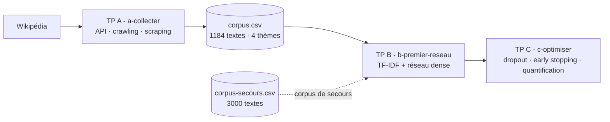

# 🌐 Web Scraping to RNN

> Du web scraping à l'entraînement d'un réseau de neurones — un pipeline NLP complet, du HTML brut au modèle quantifié

[](https://python.org)
[](https://tensorflow.org)
[](https://scikit-learn.org)
[](https://jupyter.org)

## 📑 Table des matières

- [Description](#-description)
- [Exercices](#-exercices)
- [Architecture](#-architecture)
- [Prérequis](#-prérequis)
- [Structure du projet](#-structure-du-projet)
- [Auteurs](#-auteurs)
- [Licence](#-licence)

## 📖 Description

Trois notebooks progressifs qui couvrent un pipeline NLP de bout en bout : **collecter** un corpus de textes sur Wikipédia (API, crawling, scraping), **entraîner** un réseau de neurones dense à retrouver le thème d'un texte, puis **optimiser** ce réseau (hyperparamètres, surapprentissage, quantification).

Chaque notebook est un TP guidé en 15-16 étapes, avec des contrôles de validation et des questions de compréhension.

## 🎯 Exercices

| TP | Notebook | Sujet | Compétences |
|----|----------|-------|-------------|
| A | [a-collecter.ipynb](notebooks/a-collecter.ipynb) | Collecter des données : API, crawling et scraping | `robots.txt`, `User-Agent`, pagination d'API, parcours d'arbre de catégories, `BeautifulSoup`, production d'un `corpus.csv` propre |
| B | [b-premier-reseau.ipynb](notebooks/b-premier-reseau.ipynb) | Votre premier réseau de neurones | TF-IDF, couches `Dense`, `softmax`, lecture des courbes, comparaison à la régression logistique, matrice de confusion |
| C | [c-optimiser.ipynb](notebooks/c-optimiser.ipynb) | Optimiser votre réseau | Taux d'apprentissage, dropout, arrêt précoce, graine et reproductibilité, quantification TFLite |

## 🏗️ Architecture

Comment les trois notebooks s'enchainent-ils ? Le corpus collecté au TP A sert de données d'entraînement aux TP B et C ; un corpus de secours est fourni si la collecte n'a pas été faite.



> [!TIP]
> Les diagrammes ci-dessus utilisent la syntaxe Mermaid, rendue nativement sur GitHub.

## 🔧 Prérequis

- **Python 3.13+**
- **Jupyter Notebook** ou **JupyterLab**
- Bibliothèques : `requests`, `bs4`, `pandas`, `matplotlib`, `scikit-learn`, `tensorflow` (cf. [`requirements.txt`](requirements.txt))

> [!IMPORTANT]
> Le TP A interroge le vrai Wikipédia : la collecte dure environ **30 minutes** pour 1200 articles (pause d'une seconde entre chaque requête, imposée par les règles d'usage de Wikimedia). Les notebooks se lisent dans l'ordre **A → B → C** ; les chemins de corpus (`CHEMIN_CORPUS`) sont définis en tête de chaque notebook.

## 📁 Structure du projet

```text
.
├── notebooks/
│   ├── a-collecter.ipynb       # TP A — collecte Wikipédia (API, crawling, scraping)
│   ├── b-premier-reseau.ipynb  # TP B — premier réseau de neurones (TF-IDF, Keras)
│   └── c-optimiser.ipynb       # TP C — optimisation (dropout, early stopping, TFLite)
├── corpus/
│   ├── corpus.csv              # Corpus collecté (1206 textes, 4 thèmes)
│   └── corpus-secours.csv      # Corpus de secours fourni (3000 textes)
├── requirements.txt            # Dépendances Python
└── README.md
```

## ✍️ Auteurs

[TheRealRPI](https://github.com/TheRealRPI) - 🧙 Sorcier de la Data | Data Engineer en formation - Simplon.co

## 📜 Licence

Projet académique - Simplon.co
